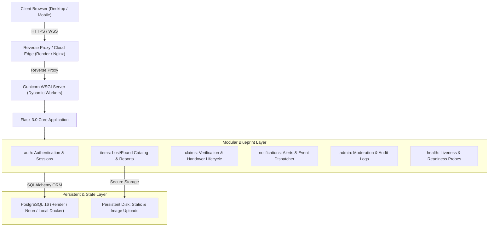
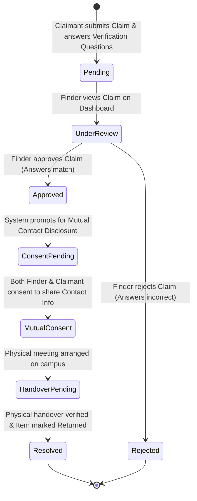
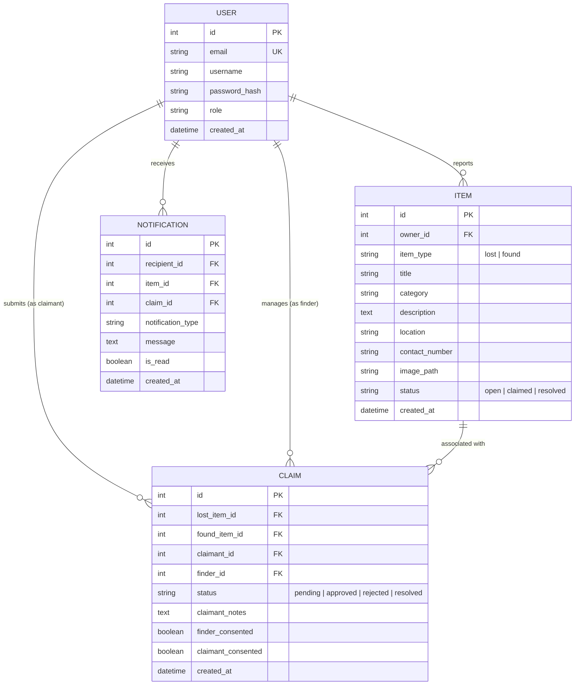

# Boomerang — System Architecture & Design Specification

## 1. High-Level System Overview

Boomerang is structured as an enterprise-grade, modular monolithic application built with Flask 3.0 and Python 3.11, adhering to domain-driven design principles. The application bridges the gap between campus students who have lost valuable items and those who have found them, without exposing sensitive personal identifiers upfront.

---

## 2. Blueprint Decomposition

The application is decomposed into isolated Flask Blueprints, each maintaining bounded context separation:

### 2.1 `auth`
- Handles user registration, authentication, password hashing (`werkzeug.security`), session lifecycle, and profile management.
- Enforces role-based access control (Student/Staff vs Campus Administrator).

### 2.2 `items`
- Manages the dual reporting workflows: **Lost Item Reports** and **Found Item Reports**.
- Enforces mandatory campus metadata: category, title, description, location found/lost, date, mandatory contact number with Indian mobile normalization (+91 / standard 10-digit format), and optional image uploads with safe file naming (`werkzeug.utils.secure_filename`).
- Houses the candidate discovery and matching query engine.

### 2.3 `claims`
- The core business engine managing the complete lifecycle of a verification claim.
- Implements two-way verification questions generated by the finder to validate ownership without giving away distinguishing marks.
- Coordinates mutual consent contact disclosure once a claim reaches the approved threshold.

### 2.4 `notifications`
- In-app notification dispatcher alerting finders and claimants on state changes (new claims submitted, claim reviewed, consent granted, handover finalized).
- Incorporates duplicate suppression logic preventing notification storms for repeat claim interactions.

### 2.5 `admin`
- Campus security and lab administrator dashboard for auditing unresolved claims, monitoring disputes, and managing flagged content.

### 2.6 `health`
- Exposes `/health/live` and `/health/ready` endpoints to cloud container orchestrators and deployment monitors for zero-downtime health probing.

---

## 3. Privacy-First Verification & Claim Lifecycle

A primary design constraint of Boomerang is the **Privacy-First Zero-Knowledge Verification** protocol. Standard lost-and-found boards expose student phone numbers, email addresses, and detailed item descriptions publicly, leading to false claims, harassment, and security risks.

### Lifecycle State Machine

### Key Security Safeguards
1. **Blind Matching:** Public item listings never expose secret verification questions or answers.
2. **Mutual Consent Exchange:** Contact numbers and emails are masked until **both** parties explicitly click "Grant Consent" following claim approval.
3. **Finder Authorization Matrix:** Authorization safeguards ensure that both canonical `finder_id` and the underlying `found_item.owner_id` resolve correctly, preventing third-party enumeration or unauthorized claim approvals.

---

## 4. Data Model & Schema Relationships

---

## 5. Security & Robustness Measures

- **SQL Injection Prevention:** 100% parameterization via SQLAlchemy ORM; direct string concatenation in queries is strictly prohibited.
- **Cross-Site Request Forgery (CSRF):** Flask-WTF CSRF tokens protect all state-changing `POST`, `PUT`, and `DELETE` requests.
- **Secure File Uploads:** Uploaded images are strictly validated against allowed extensions (`.png`, `.jpg`, `.jpeg`, `.gif`), file size caps (max 5 MB), and sanitized using UUID prefixes to prevent directory traversal attacks.
- **Database Connection Pooling:** Configured with `pool_size=10`, `max_overflow=20`, `pool_timeout=30`, and automatic connection recycling to eliminate stale connections in serverless Postgres environments like Neon.
