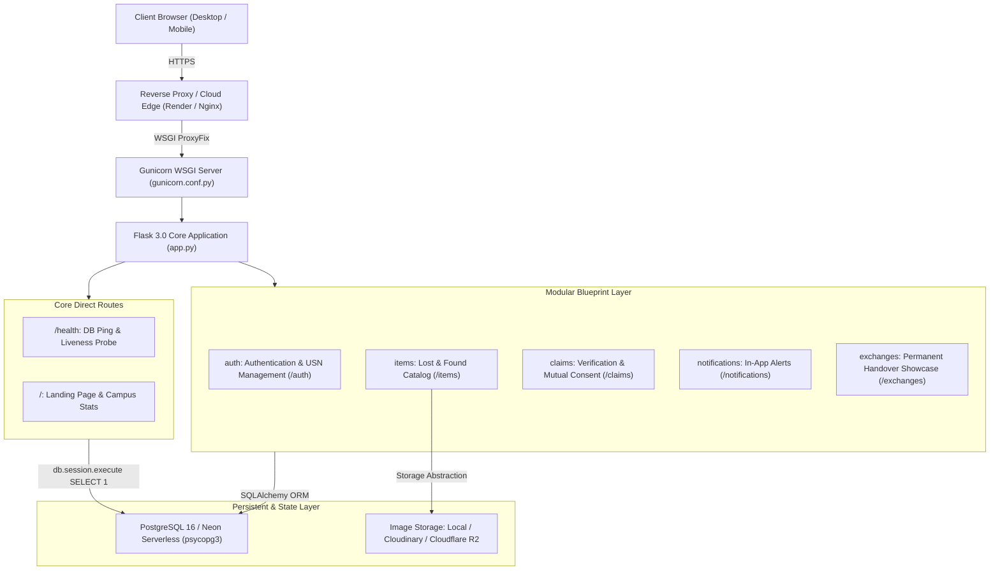
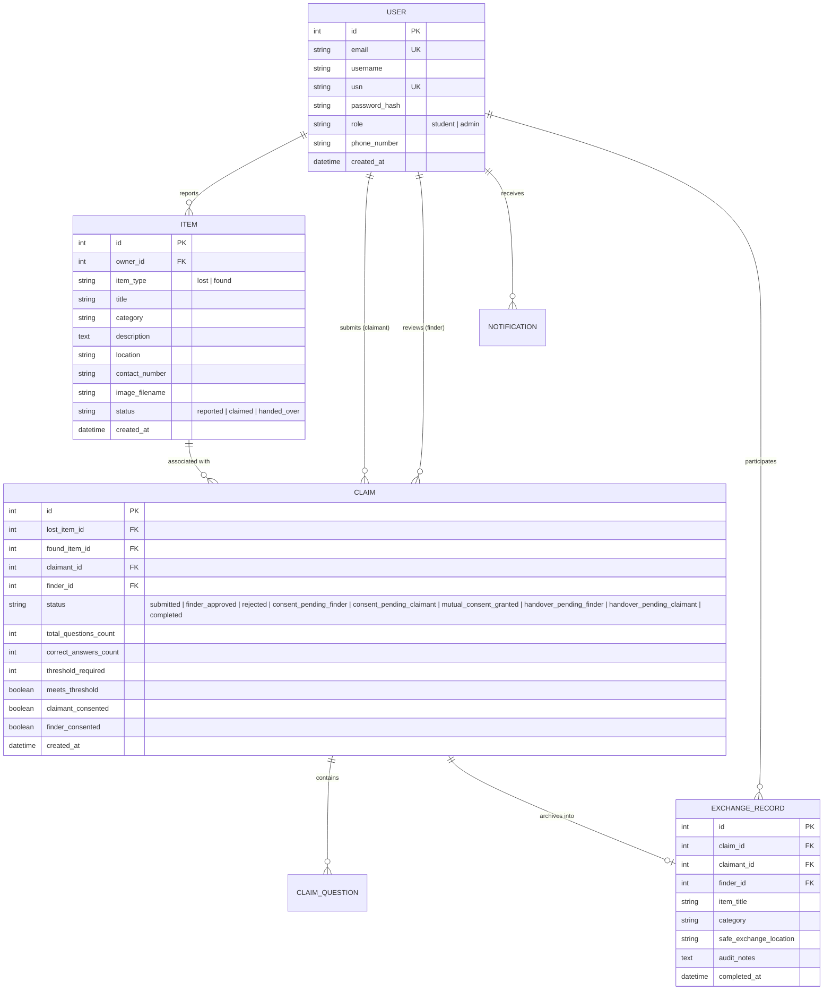

# Boomerang — System Architecture & Design Specification

## 1. High-Level System Overview

Boomerang is structured as a modular monolithic web application built with Flask 3.0 and Python 3.11, adhering to domain-driven design principles. The platform bridges the gap between campus students who have lost valuable items and finders who have reported them, without exposing sensitive personal identifiers upfront.

---

## 2. Blueprint Decomposition

The application is decomposed into five isolated Flask Blueprints, each maintaining bounded context separation:

### 2.1 `auth` (`/auth`)
- Manages user registration, login, logout, and session lifecycle using Werkzeug password hashing.
- Enforces student identity via mandatory University Seat Number (USN), validating against duplicates.
- Restricts administrative access: public registration strictly issues the `student` role; admin views require `current_user.role == "admin"`.

### 2.2 `items` (`/items`)
- Manages dual reporting workflows: **Lost Item Reports** and **Found Item Reports**.
- Enforces required campus metadata: category, title, description, location found/lost, date, and mandatory contact number (with Indian phone number normalization).
- Interfaces with the Machine Learning matching engine to discover candidate matches.

### 2.3 `claims` (`/claims`)
- Orchestrates the verification lifecycle between claimants and finders.
- Generates 6 verification questions (via Gemini Vision API or heuristic fallback).
- Evaluates answers against the dynamic 60% threshold formula ($\lceil 0.60 \times N \rceil$).
- Manages the two-sided mutual consent workflow and physical handover verification.

### 2.4 `notifications` (`/notifications`)
- Dispatches in-app alerts for match notifications, claim submissions, finder review decisions, and mutual consent disclosures.
- Incorporates suppression and idempotency checks to prevent duplicate notification storms.

### 2.5 `exchanges` (`/exchanges`)
- Provides an authenticated campus showcase of successfully reunited items.
- Enforces strict participant privacy: unrelated students see anonymized recovery milestones, while the claimant, finder, and administrators retain authorized access to transaction details.

### 2.6 Core Direct Routes (`/health`, `/`)
- Registered directly on the Flask application instance.
- `/health` performs an active database query (`SELECT 1`) to provide unauthenticated container health checks without overhead.

---

## 3. Privacy-First Verification & Claim Lifecycle

Boomerang's core innovation is the **Zero-Knowledge Verification & Mutual Consent** protocol, preventing false claims and protecting student contact information.

### Lifecycle State Machine

```mermaid
stateDiagram-v2
    [*] --> submitted: Claimant answers 6 verification questions
    
    submitted --> finder_approved: Finder reviews answers (Score >= 60% threshold)
    submitted --> rejected: Finder rejects claim (Items revert to 'reported')
    
    finder_approved --> consent_pending_finder: Claimant consents to share contact info first
    finder_approved --> consent_pending_claimant: Finder consents to share contact info first
    
    consent_pending_finder --> mutual_consent_granted: Finder grants mutual consent
    consent_pending_claimant --> mutual_consent_granted: Claimant grants mutual consent
    
    mutual_consent_granted --> handover_pending_claimant: Finder confirms physical handover first
    mutual_consent_granted --> handover_pending_finder: Claimant confirms physical receipt first
    
    handover_pending_claimant --> completed: Claimant confirms physical receipt
    handover_pending_finder --> completed: Finder confirms physical handover
    
    completed --> [*]: Permanent ExchangeRecord generated; Items marked 'handed_over'
    rejected --> [*]
```

### Authorization Matrix & Student B Protection
1. **Finder Authorization Check:**
   - Canonical authorization: `claim.finder_id == current_user.id`.
   - Ownership fallback: `claim.found_item.owner_id == current_user.id` (protects legitimate finders even if `finder_id` was historically unaligned).
   - Strict item type checks: ensures `found_item.item_type == "found"` and `lost_item.item_type == "lost"`.
2. **Claimant Protection:** Claimants can view their submitted answers but can never inspect finder scoring rubrics, percentage scores, or private finder notes.
3. **Contact Disclosure Gate:** Contact numbers and emails remain hidden until `claim.status == "mutual_consent_granted"`.

---

## 4. Data Model & Schema Relationships

---

## 5. Database Immutability & Security Architecture

1. **Dual-Layer Immutability Triggers:** Completed exchange records are permanently protected against tampering. SQLAlchemy ORM listeners (`before_update`, `before_delete`) block record modification, reinforced by database-level triggers on PostgreSQL and SQLite.
2. **Atomic Schema Initialization:** Tables and triggers are initialized at application startup using PostgreSQL advisory transaction locks (`pg_advisory_xact_lock`), preventing DDL race conditions across multi-worker deployments.
3. **Connection Pooling:** SQLAlchemy engine configured with `pool_pre_ping=True`, `pool_recycle=300`, and bounded pool sizing to ensure reliable connectivity with serverless PostgreSQL hosts such as Neon.
