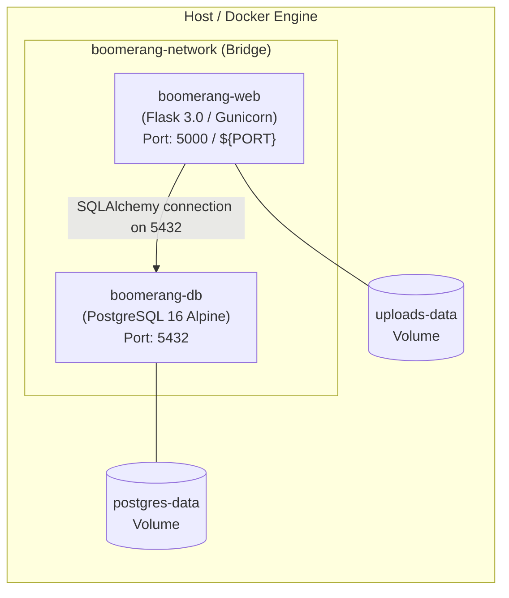

# Boomerang — Containerization & Docker DevOps Infrastructure

## 1. Containerization Strategy Overview

Boomerang utilizes Docker containerization to achieve reliable environment parity across local student development machines, continuous integration (CI) runners, and production cloud hosting platforms (such as Render).

The containerized topology operates as a dual-container architecture:
1. **Web Application Container:** Lightweight Python 3.11 runtime executing the Flask core via Gunicorn WSGI.
2. **Database Container:** PostgreSQL 16 Alpine container providing relational storage, ACID compliance, and schema persistence.



---

## 2. Dockerfile Specification

The production Dockerfile is engineered using `python:3.11-slim` to minimize image attack surface and final image size (~180MB) while maintaining fast build caching.

```dockerfile
# Multi-stage / optimized slim build
FROM python:3.11-slim as runtime

# Prevent Python from writing .pyc files and enable unbuffered logging
ENV PYTHONDONTWRITEBYTECODE=1 \
    PYTHONUNBUFFERED=1 \
    PORT=5000 \
    FLASK_ENV=production

# Install essential system dependencies (libpq for psycopg2)
RUN apt-get update && apt-get install -y --no-install-recommends \
    libpq-dev \
    gcc \
    curl \
    && rm -rf /var/lib/apt/lists/*

WORKDIR /app

# Install Python dependencies first for optimal Docker layer caching
COPY requirements.txt .
RUN pip install --no-cache-dir -r requirements.txt

# Copy application source code
COPY . .

# Create uploads directory and non-root application user for defense-in-depth
RUN mkdir -p /app/uploads && \
    useradd -u 1000 -m appuser && \
    chown -R appuser:appuser /app

USER appuser

# Health check probe against Flask health endpoint
HEALTHCHECK --interval=30s --timeout=5s --start-period=10s --retries=3 \
    CMD curl -f http://localhost:${PORT}/health/live || exit 1

EXPOSE ${PORT}

# Dynamic port binding using shell substitution for Render / Cloud deployment
CMD sh -c "gunicorn --bind 0.0.0.0:${PORT} --workers 3 --threads 2 --timeout 60 wsgi:app"
```

### Key Dockerfile Features
- **Non-Root Execution:** Container processes execute as `appuser` (UID 1000) rather than `root`, mitigating host escalation vulnerabilities.
- **Dynamic Port Binding:** The startup command `sh -c "gunicorn --bind 0.0.0.0:${PORT} ..."` evaluates `${PORT}` at runtime, allowing cloud platforms like Render or AWS ECS to inject custom port allocations seamlessly.
- **Layer Caching:** `requirements.txt` is copied and installed prior to copying the application source tree, avoiding dependency re-downloads on code-only commits.

---

## 3. Docker Compose Orchestration

For local development and integration testing, `docker-compose.yml` orchestrates the complete stack with zero manual service configuration.

```yaml
version: '3.8'

services:
  web:
    build:
      context: .
      dockerfile: Dockerfile
    container_name: boomerang-web
    restart: unless-stopped
    ports:
      - "5000:5000"
    environment:
      - FLASK_ENV=development
      - FLASK_APP=wsgi.py
      - SECRET_KEY=dev-secret-key-change-in-production
      - DATABASE_URL=postgresql://boomerang_user:boomerang_pass@db:5432/boomerang_db
      - PORT=5000
    depends_on:
      db:
        condition: service_healthy
    volumes:
      - .:/app
      - uploads_data:/app/uploads
    networks:
      - boomerang-net

  db:
    image: postgres:16-alpine
    container_name: boomerang-db
    restart: unless-stopped
    environment:
      - POSTGRES_DB=boomerang_db
      - POSTGRES_USER=boomerang_user
      - POSTGRES_PASSWORD=boomerang_pass
    ports:
      - "5432:5432"
    volumes:
      - postgres_data:/var/lib/postgresql/data
    healthcheck:
      test: ["CMD-SHELL", "pg_isready -U boomerang_user -d boomerang_db"]
      interval: 10s
      timeout: 5s
      retries: 5
    networks:
      - boomerang-net

volumes:
  postgres_data:
    driver: local
  uploads_data:
    driver: local

networks:
  boomerang-net:
    driver: bridge
```

---

## 4. Volume & Data Lifecycle Management

1. **`postgres_data` Volume:**
   - Mounts to `/var/lib/postgresql/data`.
   - Preserves user accounts, item listings, claims, and notification history across container restarts and rebuilds (`docker compose down && docker compose up -d`).

2. **`uploads_data` Volume:**
   - Mounts to `/app/uploads`.
   - Protects uploaded item photographs from being wiped when the application container is updated or redeployed.

---

## 5. Container Health Probes

Boomerang implements two dedicated health monitoring endpoints conforming to Kubernetes and PaaS container standards:

- **Liveness Probe (`/health/live`):**
  - Evaluates whether the Gunicorn master process and worker threads are responsive.
  - Returns `HTTP 200 {"status": "ok"}`.
  
- **Readiness Probe (`/health/ready`):**
  - Executes an active `SELECT 1` query via SQLAlchemy against the PostgreSQL database to confirm database connection pool availability.
  - Returns `HTTP 200 {"status": "ready", "database": "connected"}` or `HTTP 503` if the database is unreachable, instructing the load balancer not to route traffic to the container.

---

## 6. Local Quickstart Commands

```bash
# 1. Build and launch services in background
docker compose up -d --build

# 2. Inspect running containers and health status
docker compose ps

# 3. Stream web container logs
docker compose logs -f web

# 4. Execute database migrations / setup inside container
docker compose exec web python -m flask db upgrade

# 5. Run test suite inside container environment
docker compose exec web pytest

# 6. Graceful shutdown
docker compose down
```
